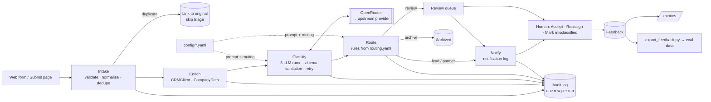

# Architecture

## Overview

## Data flow

1. **Intake** (`pipeline/intake.py`): Pydantic validates the form, using the fixed lists and a 10–5000 character description. The original text is stored exactly as submitted. A whitespace-normalised copy is used for the dedupe hash: sha256 of the email plus the normalised, lowercased text. A match within 7 days links the new enquiry to the original and skips triage, so no second notification goes out.
2. **Enrich** (`pipeline/enrich.py`): `CRMClient.lookup(email_domain, company_name)` and `CompanyData.lookup(company_name)` are abstract interfaces. Each has a mock that reads `config/crm_clients.json`.
   - Free-mail domains never match on domain, only on name.
   - The result includes existing client, relationship partner, conflict flag, and stated vs recorded size and industry.
   - Enrichment is best-effort: an exception is recorded and the pipeline continues.
3. **Classify** (`pipeline/classify.py`):
   - **Calls:** three concurrent calls with the same prompt. Run 0 is the result; runs 1–2 only vote.
   - **Prompt:** generated from the YAML files (`llm/prompts.py`). The enquiry goes inside `<enquiry>` tags marked as untrusted, and the tags are escaped so submitted text can't close them early.
   - **Validation:** output is checked against a strict JSON schema, whose enums come from the taxonomy, then again by Pydantic against the taxonomy ids.
   - **Retries:** each run retries once on an API error or invalid output, with backoff for 429/502/503. If run 0 still fails, the result is `classification_failed`.
   - **No confidence scores:** the model is never asked for one. Agreement across runs is recorded instead.
4. **Route** (`pipeline/route.py`): a pure function over the classification, the enrichment and the stated urgency. It applies the rules in `routing.yaml` order:
   1. hard stop (injection, conflict, classification failure) → review;
   2. not an enquiry → archive;
   3. existing client → partner, with the line lead copied;
   4. other review triggers → review;
   5. complex + high urgency → lead, with the practice head copied;
   6. default → lead.

   Every rule evaluated goes into the trace with its result. The model can only output taxonomy ids, so it cannot name a person. Routing to "the CEO" has no path.
5. **Notify** (`pipeline/notify.py`): writes a rendered email or Slack message to the notification log, with Accept/Reassign links. Archived and duplicate enquiries send nothing.
6. **Audit** (`pipeline/run.py`): one `PipelineRun` row per run. It holds the enrichment output, prompt version, requested and answering model, provider, all raw outputs (including failed attempts), the parsed result, the routing trace, the final destination, latency per step, tokens and reported cost. Logs go to stdout as one JSON line per step.

`run_pipeline()` is a plain function. The web app calls it in a background thread and polls progress over HTMX. A job queue could call the same function unchanged.

## Model and API choices

- **OpenRouter through the `openai` SDK.** All OpenRouter-specific code is in `llm/client.py`, behind the `LLMClient` interface. That interface has two methods: `complete_json` and `supports_temperature`.
- **`require_parameters: true` on every call.** Without it, a request can land on a provider that ignores `response_format` and returns free text.
- **Structured output via strict `json_schema`, not a forced tool call** (D6). Temperature is sent only to models that list it in OpenRouter's `/models` (D7).
- **Default model:** `anthropic/claude-sonnet-5.5`. It gives the best complexity accuracy and the most useful rationales on the eval. Haiku matches it on routing at 1/16th of the cost, which is the obvious lever if volume grows (README, Evaluation).

## Integration points

| Component | Demo | Production equivalent |
|---|---|---|
| Web form | Submit page | POST from the website form handler (same `EnquiryIn` schema) |
| CRM lookup | `MockCRMClient` (JSON file) | `CRMClient` implementation for Dynamics / Salesforce / InterAction |
| Company data | `MockCompanyData` (JSON file) | Companies House / D&B / internal client master |
| Conflict check | `conflict_flag` in the JSON file | The firm's conflicts system; arguably a hard gate before any routing |
| LLM | OpenRouter | OpenRouter with ZDR-only providers, or the chosen provider directly (one new `LLMClient` class) |
| Notifications | `Notification` table + log page | Email (Graph / SES) and Slack, with signed Accept/Reassign links |
| Database | SQLite on a Docker volume | Postgres (SQLModel; only the URL changes) |
| Auth | None | SSO (Entra ID / Okta) in front of the app; actions attributed to the user |
| Pipeline execution | Background thread per submission | A queue worker calling the same `run_pipeline` |

## Real, mocked, or not built

| Component | Status |
|---|---|
| Validation, normalisation, dedupe | Real |
| LLM classification, 3-run agreement, retry, fallback model | Real (live OpenRouter calls) |
| Prompt generated from YAML | Real |
| Routing rules, trace, review triggers | Real |
| Audit log, per-call cost, tokens, provider | Real |
| Feedback (accept / reassign / misclassified) and export to JSONL | Real |
| Metrics page | Real (computed from the database) |
| Evaluation harness | Real |
| CRM, company data | Mocked (JSON) → CRM / company-data APIs |
| Conflict check | Mocked (a CRM field) → conflicts system |
| Email / Slack | Mocked (notification log) → Graph / Slack API |
| Auth / SSO, user attribution | Not built |
| Job queue, horizontal scale | Not built (about 10 enquiries a day) |
| Data retention / PII redaction | Not built |
| Fine-tuned or embedding classifier | Not built (next step once feedback data exists) |

## Instrumented from day one

- **Per run:** latency per step, tokens, reported cost, model and provider, and agreement counts. Raw outputs from every attempt are stored, including the failed ones.
- **Per enquiry:** the full routing trace, the review reasons, and every human action with old value, new value and reason.
- **`/metrics`:** reassignment rate (overall and per predicted line), review-queue rate with reasons, service-line mix over 7 and 30 days, classification failure rate, p50/p95 latency, providers and models seen.
- **`make eval`:** the regression gate for any prompt, model or taxonomy change. Results are versioned by `PROMPT_VERSION`.

## Rollout plan

1. **Shadow mode (2–4 weeks).** The analyst keeps triaging by hand. The system runs on every enquiry and writes its decision, but sends no notifications. Each week, compare its decisions with the analyst's.
   - *Exit criteria:* review recall ≥ 95% against the analyst's "should a human look" judgement, auto-route precision ≥ 95%.
   - *Also measure* whether the 3-run agreement check catches anything. It never fired on the synthetic set.
2. **Assisted (4–8 weeks).** Notifications go to team leads with the suggested routing. Each enquiry needs one click: Accept or Reassign. The analyst works the review queue. Reassignment rate per line is the health metric; a line above about 10% gets its taxonomy entry and examples revisited.
3. **Automatic for high-confidence enquiries.** An enquiry routes without a click when it has 3/3 agreement, no flags, isn't from an existing client, and is in a line with a reassignment rate below threshold. Everything else stays assisted.
   - The review queue and the hard stops never go away.
   - A weekly `make eval`, on the synthetic set plus exported feedback, guards against model or prompt drift.

## Why OpenRouter, and its trade-offs

**For:**
- One API and one SDK across vendors, so comparing Claude, Gemini and others was a config change.
- Built-in fallbacks: the `models` array.
- Per-call cost reporting, so the eval's cost per 1,000 is measured, not estimated.
- Visibility of which upstream provider served each request. That matters because the same slug can be served by Anthropic, Bedrock, Vertex or Azure, with small behavioural differences.

**Against:**
- **A third party sits between the firm and the model provider.** Client enquiries contain confidential commercial information, so for production:
  - Restrict routing to providers with zero data retention, using OpenRouter's data policy settings or a per-request `provider` preference. Disallow providers that train on prompts.
  - Confirm OpenRouter's own retention and logging terms and get them into the DPA. Its prompt logging is off unless enabled; keep it off.
  - Redact what isn't needed (personal names, phone numbers) before the call.
- **An extra network hop:** some added latency, small next to 4–10s of model time. It is also another dependency whose outages affect availability; the fallback is to retry, then the review queue.
- **Silent provider variation:** two calls to the same slug may hit different providers. The audit log stores the provider per call so differences can be traced, and `require_parameters` prevents the worst case (schema ignored).
- **Exit path:** once evaluation has picked a model, call that provider directly in production, for example Anthropic's API or Bedrock in the firm's own cloud account. That is one new class implementing `LLMClient`; the prompt, schema, validation, routing and eval harness don't change. Keep OpenRouter for the evaluation workflow, where cross-vendor comparison is the point.
