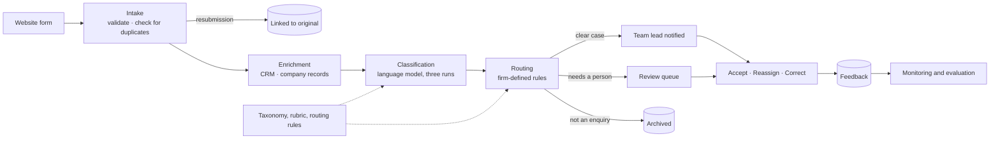

# Intake Triage: Architecture

## Overview

The system sits between the firm's website enquiry form and its team leads. Each enquiry passes through five steps: intake, enrichment, classification, routing and notification. Every step writes to an audit record.

A language model makes the judgement calls: what the client needs, how complex it is, and how urgent. Who receives the enquiry is decided by plain, predictable rules that the firm controls.

## How an enquiry moves through the system

**Intake.** The submission is validated, and the original wording is kept exactly as written. If the same person sends essentially the same text again within a week, it is linked to the first submission instead of being triaged twice.

**Enrichment.** The CRM shows:
- whether the company is an existing client, and since when;
- the relationship partner, the services the firm already provides, and the most recent engagement;
- any open opportunities;
- any conflict of interest.

Subsidiaries are resolved to their group. A newly acquired business inherits its parent's client status, partner and conflicts, so it's handled as part of that client from day one. Company records add headcount, revenue, headquarters and ownership. Where the client's stated size or industry disagrees with the record, the difference is flagged. For an audit client asking for other services, the team lead sees a reminder to check independence.

In the prototype these lookups read sample data, through the same interfaces a real integration would use. A failed lookup never holds an enquiry up.

**Classification.** The model's instructions are generated from two documents the firm owns: the service-line definitions and the complexity and urgency rubric. The enquiry is passed in as untrusted text, and any instructions inside it are ignored and flagged.

The model returns:
- the primary and secondary service lines;
- complexity, with a rationale that cites the rubric;
- urgency as the model reads it;
- key facts and open questions for the client;
- risk flags;
- a one-line summary.

Every response is checked against a strict format. A failed response is retried once; if it fails again, the enquiry goes to a person.

Each enquiry is classified three times. Models are poor judges of their own confidence, so the system compares the three answers instead of asking for a confidence score. Disagreement on the service line sends the enquiry to review.

**Routing.** Routing is kept away from the model. These rules apply in order, and the first one that matches decides:

1. Possible prompt injection, a conflict of interest, or a failed classification always goes to a person.
2. Spam, job applications and sales pitches are archived.
3. Existing clients go to their relationship partner, with the service-line lead copied.
4. Vague or out-of-scope enquiries, and those where the runs disagreed, go to the review queue.
5. Complex, urgent work goes to the service-line lead, with the practice head copied.
6. Everything else goes to the service-line lead.

The model can only choose from the firm's service lines, so it cannot name a person or invent a destination. Every rule checked, and the one that decided, is recorded and shown alongside the enquiry.

**Notification and audit.** The chosen lead receives the summary, with one-click links to accept the enquiry or pass it on. Each run is stored in full: the submission, the enrichment, all three model responses, the routing decision, timings, tokens and cost. The pipeline is a single function. At about ten enquiries a day it runs as each one arrives, and it could move onto a job queue later without changes.

## Keeping the business logic in the firm's hands

The service-line definitions, the rubric, the team leads and the routing rules live in configuration, not code. Practice operations can change them on a configuration screen.

Each change is validated first. The system then replays every past enquiry under the proposed rules and lists any that would now be routed differently. Saved changes take effect immediately, are logged with a note, and can be reverted. Every decision records which version of the prompt and configuration produced it.

## Model and API choices

Models are accessed through OpenRouter: one interface across vendors, automatic fallback to a backup model, and the actual cost reported on every call. Each request requires the provider to honour the structured format, so it can't silently land somewhere that would ignore it.

Three models were tested on 50 hand-labelled enquiries:
- **Claude Sonnet 5.5** is the default. It had the best complexity accuracy (90%) and the clearest reasoning.
- **Claude Haiku 5.5** matched it on routing and every safety measure at about a sixteenth of the cost, but managed only 66% on complexity.
- **Gemini 3.8 Flash** scored 73% on complexity and was the slowest.

At this volume the cost difference is small, so quality wins.

**The trade-off** is that OpenRouter puts a third party in the path of client data. In production I would:
- restrict it to zero-retention providers;
- keep prompt logging off and cover it in the data processing agreement;
- remove personal details before sending.

Once a model is chosen, calling that provider directly from the firm's own cloud account is a small change, because the model sits behind a single interface.

## Next step: on-demand external enrichment

Internal records only cover companies the firm already knows, and most enquiries come from prospects. The next step is to look outward, but only when it would change a decision.

**What to fetch:**
- headcount, revenue and sector;
- ownership and group structure (parents, subsidiaries, recent acquisitions), which strengthens the conflict check;
- recent events such as funding rounds, acquisitions or regulatory action, which change urgency or complexity.

**Where from:**
- **Exa,** a search engine built for AI applications. It's suited to finding recent news and filings about a company from its name or web domain.
- **Parallel,** a web research API that answers structured questions ("who owns this company?") with cited sources.
- **Clay,** an enrichment platform that combines many commercial data providers. It's useful for firmographics such as headcount and revenue.

**When:** on demand, not for every enquiry. It runs when the company isn't in the CRM, when the work looks complex or high-value, or when a team lead asks for it with one click from the enquiry.

**Guardrails:**
- Send only the company name and web domain, never the enquiry text or the contact's personal details.
- Cache results with their source and date, and label them as external and unverified alongside internal data.
- External findings can send an enquiry to review (for example, a parent company the firm is conflicted with). They can never route it to a partner on their own.
- Cap the cost per enquiry, and confirm the lawful basis for processing with the firm's data protection team.

Each provider would be another implementation of the existing company-data interface, so routing and the user interface would not change.

## Integration points

| Component | Prototype | Production |
|---|---|---|
| Enquiry form | Built-in submission page | Website form posts the same fields |
| Client and company data | Sample CRM and company records (28 companies, including group structures) | CRM (Dynamics, Salesforce) and Companies House or D&B, with Exa, Parallel or Clay on demand for prospects |
| Conflict check | Field in the sample data | The firm's conflicts system, checked before routing |
| Language model | OpenRouter | Zero-retention providers only, or the provider directly |
| Notifications | Rendered and logged | Email and Slack with signed action links |
| Storage | SQLite | Postgres |
| Access | Open | Single sign-on; configuration limited to administrators |

## What is measured from day one

Every model call records its latency, token usage, cost, which model and provider answered, and whether the three runs agreed. Every enquiry keeps its routing trail and any human action on it, with the reason.

A health page tracks:
- model errors per service line, with reassignments for workload counted separately;
- how often enquiries go to review, and why;
- the mix of service lines over 7 and 30 days;
- failures and response times.

A test suite reruns the full pipeline over the labelled enquiries before any change to the model, prompt or configuration is trusted.

## Rollout

1. **Shadow mode (two to four weeks).** The system runs silently alongside the analyst, and the two are compared weekly. It moves on once at least 95% of enquiries that need a person are caught and at least 95% of automatic routes are correct.
2. **Assisted.** Leads receive the suggestion and confirm it with a click. The analyst handles only the review queue.
3. **Automatic for clear-cut cases.** An enquiry routes without confirmation when the runs agree, nothing is flagged, it isn't from an existing client, and its service line has a low error rate. The safety checks and the review queue stay permanently.
