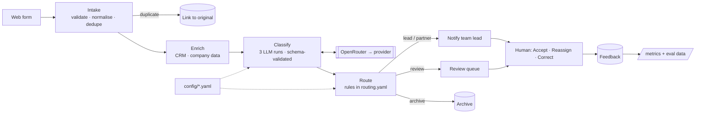

# Architecture

## Data flow

1. **Intake.** The form is validated against fixed lists (description 10–5000 characters). The original text is stored verbatim. A hash of the email plus whitespace-normalised text links resubmissions within 7 days, and a linked duplicate skips triage.
2. **Enrich.** `CRMClient` and `CompanyData` interfaces, mocked from JSON, return existing client, relationship partner, conflict flag, and stated vs recorded size. Enrichment is best-effort: a failure is logged and never blocks the enquiry.
3. **Classify.**
   - **Prompt:** generated from `taxonomy.yaml` and `rubric.yaml`. The enquiry sits in `<enquiry>` tags marked as untrusted.
   - **Calls:** three concurrent calls. Run 0 is the answer; runs 1–2 vote, and agreement on service line and complexity is recorded. The model is never asked for a confidence score.
   - **Output:** a strict JSON schema with enums taken from the taxonomy, validated again with Pydantic. Each run retries once on an API or validation error. If run 0 still fails, the result is `classification_failed`.
   - **Fields:** primary and secondary service lines, complexity with a rationale citing the rubric, inferred urgency, key entities, questions to ask the client, flags, and a one-line summary.
4. **Route.** A pure function, so the same inputs always give the same answer. It applies the rules below in order, and the first rule that fires decides:
   1. hard stop (injection, conflict or failure) → review;
   2. not an enquiry → archive;
   3. existing client → relationship partner, with the line lead copied;
   4. other review triggers (runs disagree, vague, out of scope) → review;
   5. complex + high urgency → lead, with the practice head copied;
   6. otherwise → lead.

   Every rule checked is written to a trace that the UI shows. The model can only name taxonomy ids, never a person.
5. **Notify and audit.**
   - **Notify:** a rendered email or Slack message with Accept and Reassign links, written to a log.
   - **Audit:** one row per run, holding the enrichment, prompt version, requested and answering model, provider, all raw outputs, the parsed result, the trace, the destination, latency per step, tokens and reported cost.

`run_pipeline()` is one callable. The demo runs it in a background thread; a job queue could call it unchanged.

## Model and API choices

- **OpenRouter through the `openai` SDK, behind a one-class `LLMClient` interface.** Every request sends `provider.require_parameters: true`, so a provider can't silently ignore the schema, and `usage.include: true` for per-call cost.
- **Default `anthropic/claude-sonnet-5.5`.** On the eval it had the best complexity accuracy (90%) and the most useful rationales.
- **`claude-haiku-5.5` matched it on routing and every safety metric at 1/16th of the cost** ($2.50 vs $40 per 1,000), but scored only 66% on complexity.
- **Structured output is `json_schema`, not a forced tool call,** because current Claude providers on OpenRouter reject forced `tool_choice` (DECISIONS D6).

**Why OpenRouter.** One API across vendors makes model comparison a config change, and it gives built-in fallbacks and measured cost.

**Against it:** a third party handles client data, and there is an extra network hop. For production:
- restrict to zero-data-retention providers;
- keep prompt logging off and cover OpenRouter in the DPA;
- redact names and phone numbers before the call.

Once the eval has picked a model, the clean option is to call that provider directly, for example Bedrock in the firm's own account. That is one new `LLMClient` class. Keep OpenRouter for evaluation.

## Integration points

| Component | In the prototype | Production |
|---|---|---|
| Web form | Submit page (`EnquiryIn` schema) | Website form handler POSTs the same schema |
| CRM / company data | Mocked from JSON behind interfaces | Dynamics/Salesforce, Companies House/D&B implementations |
| Conflict check | A CRM field | The firm's conflicts system, as a hard gate |
| LLM | OpenRouter, live | ZDR-restricted OpenRouter, or the provider directly |
| Notifications | Logged, rendered | Email (Graph) and Slack, with signed Accept/Reassign links |
| Storage | SQLite | Postgres (the URL changes, nothing else) |
| Auth | Not built | SSO in front; every action attributed to a user |

## Instrumented from day one

- **Per call:** latency, tokens, reported cost, model and provider, agreement.
- **Per enquiry:** the routing trace and every human action (old value, new value, reason).
- **`/metrics`:** reassignment rate overall and per predicted line, review rate and reasons, 7- and 30-day service-line mix, failure rate, p50/p95 latency.
- **`make eval`:** the regression gate for any prompt, model or taxonomy change, versioned by `PROMPT_VERSION`.

## Rollout

1. **Shadow mode (2–4 weeks).** The system runs silently alongside the analyst and is compared weekly.
   - *Exit criteria:* review recall and auto-route precision of at least 95%.
   - *Also measure* whether run disagreement catches anything.
2. **Assisted.** Team leads get the suggestion and confirm it with one click. The analyst works only the review queue.
3. **Automatic for high-confidence enquiries:** 3/3 agreement, no flags, not an existing client, and a line with a low reassignment rate. The hard stops and the review queue stay permanently.
